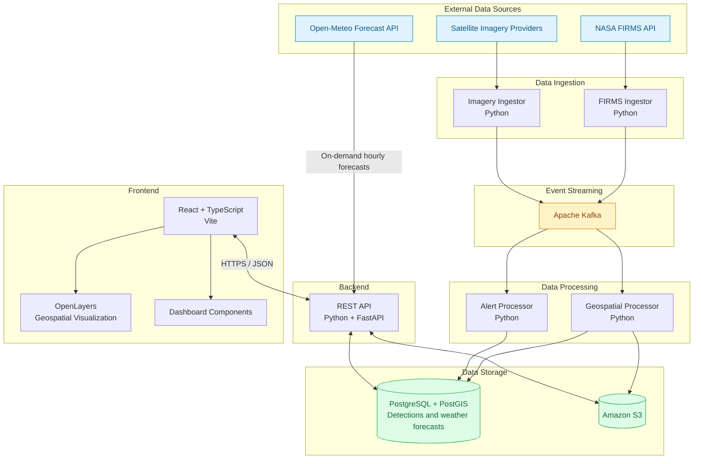

# Wildfire Intelligence Platform

**High-Level Software Architecture**  
**Version:** 0.1  
**Status:** Proposed

## Architecture Diagram

## Architectural Principles

- **Frontend:** React with OpenLayers for mapping, weather overlays, and satellite visualization.
- **Backend API:** FastAPI provides data access and business logic without coupling the frontend directly to storage.
- **Ingestion:** FIRMS data is published to Kafka; the API fetches and caches Open-Meteo forecasts on demand.
- **Processing:** Kafka consumers normalize, enrich, and persist geospatial information.
- **Storage:** PostGIS handles spatial queries, detections, and hourly forecasts; S3 stores large imagery and raster datasets.
- **Containers:** Each application service runs in its own Podman container, with separate build and runtime stages.
- **Infrastructure:** AWS CDK manages infrastructure provisioning; infrastructure details are outside this code-level diagram.

## Open Design Question

Determine whether the frontend should retrieve geospatial raster data directly from S3 using signed URLs or exclusively through the backend API.
