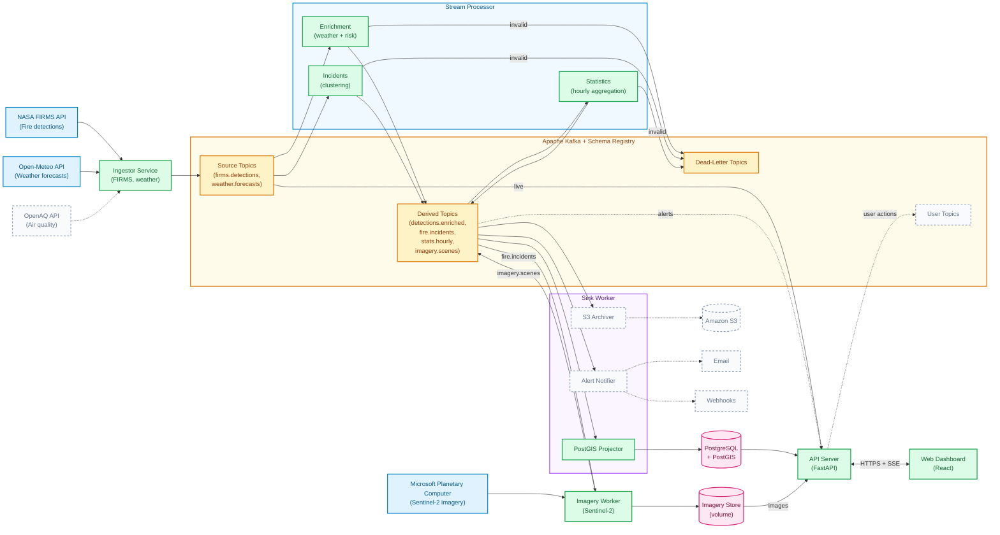

# Wildfire Intelligence Platform

**High-Level Software Architecture**  
**Version:** 0.3  
**Status:** Proposed

This is the target architecture. The diagram marks which parts are already
implemented; [the roadmap](../roadmap.md) describes how the project gets to the
rest.

## Architecture Diagram

Solid boxes and arrows are implemented; dashed grey boxes and dotted arrows
are planned. Arrows show the direction data flows.

## Services

| Service | Jobs | Responsibilities | Reads | Writes |
|---|---|---|---|---|
| **Ingestor** | — | Scheduled data producers for external sources | NASA FIRMS API, Open-Meteo API | `firms.detections`, `weather.forecasts` |
| **Imagery Worker** | Sentinel-2 | Scheduled satellite imagery of current fire incidents | `fire.incidents`, Microsoft Planetary Computer | `imagery.scenes`, the imagery store |
| **Stream Processor** | Enrichment, Incidents, Statistics, Alert (planned) | Add weather/country/risk to detections; cluster incidents; aggregate statistics; match watch areas | Source topics, compacted topics | Derived topics, `*.dlq` |
| **Sink Worker** | PostGIS Projector, S3 Archiver, Alert Notifier (planned) | Persist projections to database; archive to S3; send notifications | All topics | PostgreSQL, S3, email/webhook |
| **API Server** | — | Query incidents/hotspots/weather; stream live updates; handle user actions | PostgreSQL, Kafka (live stream) | User topics (`watch-areas`, `field-reports`, `alert-acks`) |
| **Web Dashboard** | — | Display live fire map; show incidents, weather, alerts; replay events | API Server | — |

## Topics

| Family | Topics | Status |
|---|---|---|
| **Source** | `firms.detections` | ✅ Implemented |
| | `weather.forecasts` (compacted) | ✅ Implemented |
| | `airquality.readings` | 🔲 Planned |
| **Derived** | `detections.enriched` | ✅ Implemented |
| | `fire.incidents` | ✅ Implemented |
| | `stats.hourly` | ✅ Implemented |
| | `alerts` | 🔲 Planned |
| **User** | `watch-areas` (compacted) | 🔲 Planned |
| | `field-reports` | 🔲 Planned |
| | `alert-acks` | 🔲 Planned |
| **Dead Letter** | `*.dlq` per consumer (e.g., `sink-worker.dlq`) | ✅ Implemented |

## External Systems

| System | Type | Purpose | Status |
|---|---|---|---|
| **NASA FIRMS API** | Data source | Satellite fire detections (SNPP, NOAA20) | ✅ Implemented |
| **Open-Meteo API** | Data source | Weather forecasts (temperature, wind, precipitation) | ✅ Implemented |
| **Microsoft Planetary Computer** | Data source | Sentinel-2 short-wave infrared imagery of incidents | ✅ Implemented |
| **OpenAQ API** | Data source | Air quality readings | 🔲 Planned |
| **PostgreSQL + PostGIS** | Data storage | Event projections, incidents, detection conditions | ✅ Implemented |
| **Amazon S3** | Data storage | Topic archival for long-term retention | 🔲 Planned |
| **Email / Webhooks** | Notifications | Alert delivery to users | 🔲 Planned |

## Architectural Principles

- **Event log as system of record:** Observations, forecasts, and user actions
  are Kafka events. PostGIS and S3 hold projections of the log and can be
  rebuilt by replaying topics.
- **Few services, many jobs:** Related jobs share a deployable service to keep
  the system small. Each job in the stream processor and the sink worker uses
  its own consumer group, so jobs track their offsets independently and can be
  split into separate services later without changing topics.
- **Producers:** The ingestor runs one scheduled producer per source.
  Producers are idempotent, and events are keyed by H3 cell so spatially
  related data shares a partition. Satellite imagery is acquired by a separate
  imagery worker: it depends on `fire.incidents`, its runs are slow and
  image-heavy, and restarting it must not interrupt live ingestion. Both share
  the producer runtime in `packages/producers`.
- **Schemas:** Event schemas are versioned in a schema registry. Invalid events
  go to dead-letter topics; consumers keep running.
- **Compacted topics as tables:** The latest forecast per grid cell and the
  current set of watch areas are compacted topics that stream processors join
  against.
- **Side effects at the edge:** The stream processor only reads and writes
  Kafka. Writes to PostGIS, S3, and notification channels happen in the sink
  worker, so reprocessing never sends duplicate notifications from the
  processor.
- **Backend API:** FastAPI serves queries from PostGIS, publishes user actions
  to Kafka, and subscribes to derived topics to stream live updates to the
  browser with Server-Sent Events. The API is a consumer but not a consumer
  group: each instance assigns itself all partitions manually, so every
  instance receives every event and filters it per connected client. Manual
  assignment also lets the API resume a reconnecting client from the Kafka
  offset in its `Last-Event-ID`.
- **Containers:** Each service runs in its own Podman container, with separate
  build and runtime stages.
- **Infrastructure:** AWS CDK manages infrastructure provisioning;
  infrastructure details are outside this code-level diagram.

Topic keys, schemas, dead-letter handling, and the replay procedure are
documented in [the event pipeline operations guide](../operations/event-pipeline.md).

## Open Design Questions

- Choose between Amazon MSK Serverless and a self-managed broker for the AWS
  deployment, based on cost and operational effort.
- Choose the incident clustering parameters (distance and time window) and
  validate them against historical FIRMS data.
- Decide whether alert delivery requires authentication and per-user
  subscriptions before the AWS deployment.
