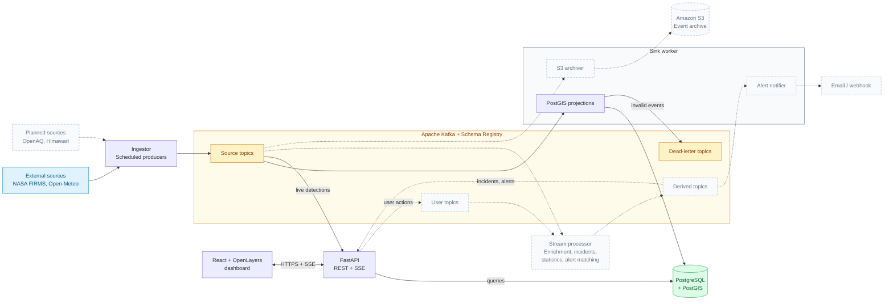

# Wildfire Intelligence Platform

**High-Level Software Architecture**  
**Version:** 0.3  
**Status:** Proposed

This is the target architecture. The diagram marks which parts are already
implemented; [the roadmap](../roadmap.md) describes how the project gets to the
rest.

## Architecture Diagram

Solid boxes and arrows are implemented (Phases 1–7); dashed grey boxes and
dotted arrows are planned.

## Services

| Service | Responsibilities | Reads | Writes |
|---|---|---|---|
| Ingestor | Scheduled FIRMS, weather, and air-quality producers | External APIs | Source topics |
| Stream processor | Weather enrichment, risk indicator, incident clustering and lifecycle, hourly statistics, watch-area matching | Source and user topics | Derived and dead-letter topics |
| Sink worker | Persist projections to PostGIS, archive topics to S3, deliver alert notifications | All topics | PostGIS, S3, email/webhook |
| API | Hotspot, incident, and weather queries; live updates over SSE; user actions | PostGIS, derived topics | User topics |
| Web | Live map, incidents, alerts, air quality, replay, pipeline status | API | — |

## Topics

| Family | Topics |
|---|---|
| Source | `firms.detections`, `weather.forecasts` (compacted), `airquality.readings` |
| User | `watch-areas` (compacted), `field-reports`, `alert-acks` |
| Derived | `detections.enriched`, `fire.incidents`, `alerts`, `stats.hourly` |
| Dead letter | One `*.dlq` topic per consuming service (`sink-worker.dlq` today) |

## Architectural Principles

- **Event log as system of record:** Observations, forecasts, and user actions
  are Kafka events. PostGIS and S3 hold projections of the log and can be
  rebuilt by replaying topics.
- **Few services, many jobs:** Related jobs share a deployable service to keep
  the system small. Each job in the stream processor and the sink worker uses
  its own consumer group, so jobs track their offsets independently and can be
  split into separate services later without changing topics.
- **Producers:** The ingestor runs one scheduled producer per source.
  Producers are idempotent, and events are keyed by H3 cell so spatially
  related data shares a partition.
- **Schemas:** Event schemas are versioned in a schema registry. Invalid events
  go to dead-letter topics; consumers keep running.
- **Compacted topics as tables:** The latest forecast per grid cell and the
  current set of watch areas are compacted topics that stream processors join
  against.
- **Side effects at the edge:** The stream processor only reads and writes
  Kafka. Writes to PostGIS, S3, and notification channels happen in the sink
  worker, so reprocessing never sends duplicate notifications from the
  processor.
- **Backend API:** FastAPI serves queries from PostGIS, publishes user actions
  to Kafka, and subscribes to derived topics to stream live updates to the
  browser with Server-Sent Events. The API is a consumer but not a consumer
  group: each instance assigns itself all partitions manually, so every
  instance receives every event and filters it per connected client. Manual
  assignment also lets the API resume a reconnecting client from the Kafka
  offset in its `Last-Event-ID`.
- **Containers:** Each service runs in its own Podman container, with separate
  build and runtime stages.
- **Infrastructure:** AWS CDK manages infrastructure provisioning;
  infrastructure details are outside this code-level diagram.

Topic keys, schemas, dead-letter handling, and the replay procedure are
documented in [the event pipeline operations guide](../operations/event-pipeline.md).

## Open Design Questions

- Choose between Amazon MSK Serverless and a self-managed broker for the AWS
  deployment, based on cost and operational effort.
- Choose the incident clustering parameters (distance and time window) and
  validate them against historical FIRMS data.
- Decide whether alert delivery requires authentication and per-user
  subscriptions before the AWS deployment.
